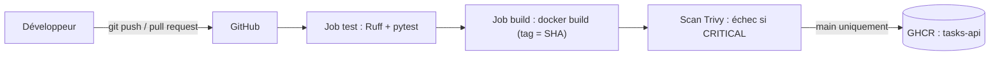
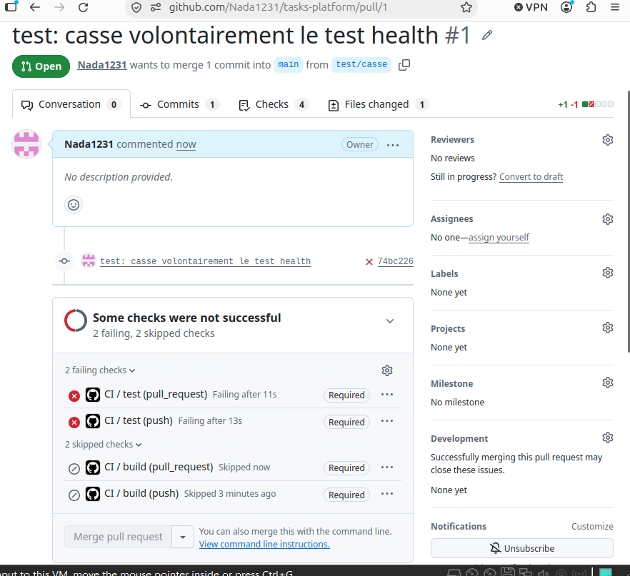

# tasks-platform


API de gestion de tâches (FastAPI + PostgreSQL) livrée par un pipeline CI/CD complet :
lint, tests, build Docker multi-étapes, scan de sécurité Trivy et publication d'image sur GHCR.

## Architecture



## Stack

| Outil | Rôle | Pourquoi |
|---|---|---|
| FastAPI + SQLAlchemy | API et accès base | Rapide à écrire, documentation auto sur `/docs` |
| PostgreSQL | Base de données | Standard en production |
| Docker (multi-étapes) | Conteneur | Image légère, exécutée en non-root |
| GitHub Actions | CI/CD | Intégré au dépôt, protection de branche |
| Ruff + pytest | Qualité du code | Lint rapide, tests automatisés |
| Trivy (image épinglée) | Scan de vulnérabilités | Bloque les failles CRITICAL |
| GHCR | Registre d'images | Authentification par `GITHUB_TOKEN`, aucun mot de passe |

## Lancer en local

```bash
# Avec PostgreSQL
docker compose -f docker/docker-compose.yml up --build
# API : http://localhost:8000/health   Documentation : http://localhost:8000/docs

# Sans Docker (SQLite)
python3 -m venv .venv && source .venv/bin/activate
pip install -r requirements-dev.txt
ruff check . && pytest
uvicorn app.main:app --reload
```

Image publiée par le pipeline :

```bash
docker run --rm -p 8000:8000 ghcr.io/nada1231/tasks-api:latest
```

## Pipeline CI/CD

À chaque push et pull request : Ruff, pytest, build de l'image (taguée avec le SHA du commit), scan Trivy.
Sur `main` uniquement : push de l'image sur GHCR.

La branche `main` est protégée : une pull request dont les tests échouent ne peut pas être fusionnée.



## Sécurité

- Conteneur exécuté en non-root (utilisateur `app`)
- Scan Trivy bloquant sur les failles CRITICAL, rapport conservé comme artefact du pipeline
- Aucun secret dans le dépôt : le push vers GHCR utilise le `GITHUB_TOKEN` fourni par GitHub
- Trivy lancé via une image Docker épinglée plutôt qu'une action tierce (voir la première panne)
- Branche `main` protégée, checks obligatoires

## Mesures

- Image : 66 Mo compressée (ce qui est téléchargé), 276 Mo décompressée sur disque
- Pipeline complet : environ 1 minute

## Ce qui a cassé et comment je l'ai réparé

| Symptôme | Cause | Solution |
|---|---|---|
| `Unable to resolve action trivy-action@0.28.0` | Tags de l'action détournés lors d'un incident de sécurité (mars 2026), puis renommés avec un préfixe `v` | Trivy lancé via `docker run ghcr.io/aquasecurity/trivy:0.69.3`, sans action tierce |
| `containerd.io : Conflicts: containerd` à l'installation de `docker.io` | Docker était déjà installé depuis le dépôt officiel | Ne rien forcer, vérifier `docker --version` et `docker run hello-world` |
| Test cassé volontairement sur une PR | Régression simulée (`assert 200 == 500`) | Check `test` rouge, `build` ignoré, fusion bloquée par la protection de branche |

## Améliorations prévues

- Réduire l'image décompressée (par exemple `uvicorn` sans l'extra `[standard]`)
- Éviter les checks en double (push et pull_request) en limitant le déclencheur `push` à `main`
- Épingler les actions GitHub par SHA de commit
- Déployer sur Kubernetes (projet 3), puis ajouter le monitoring (projet 4)
